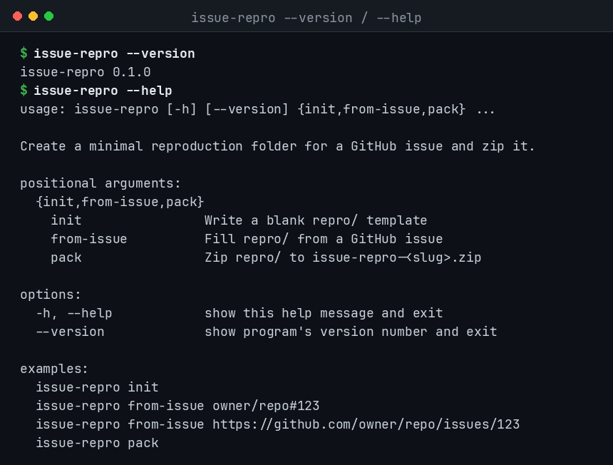
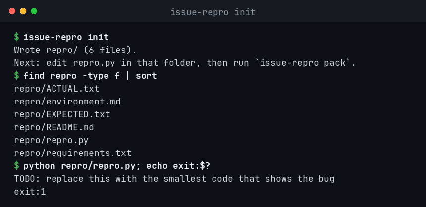
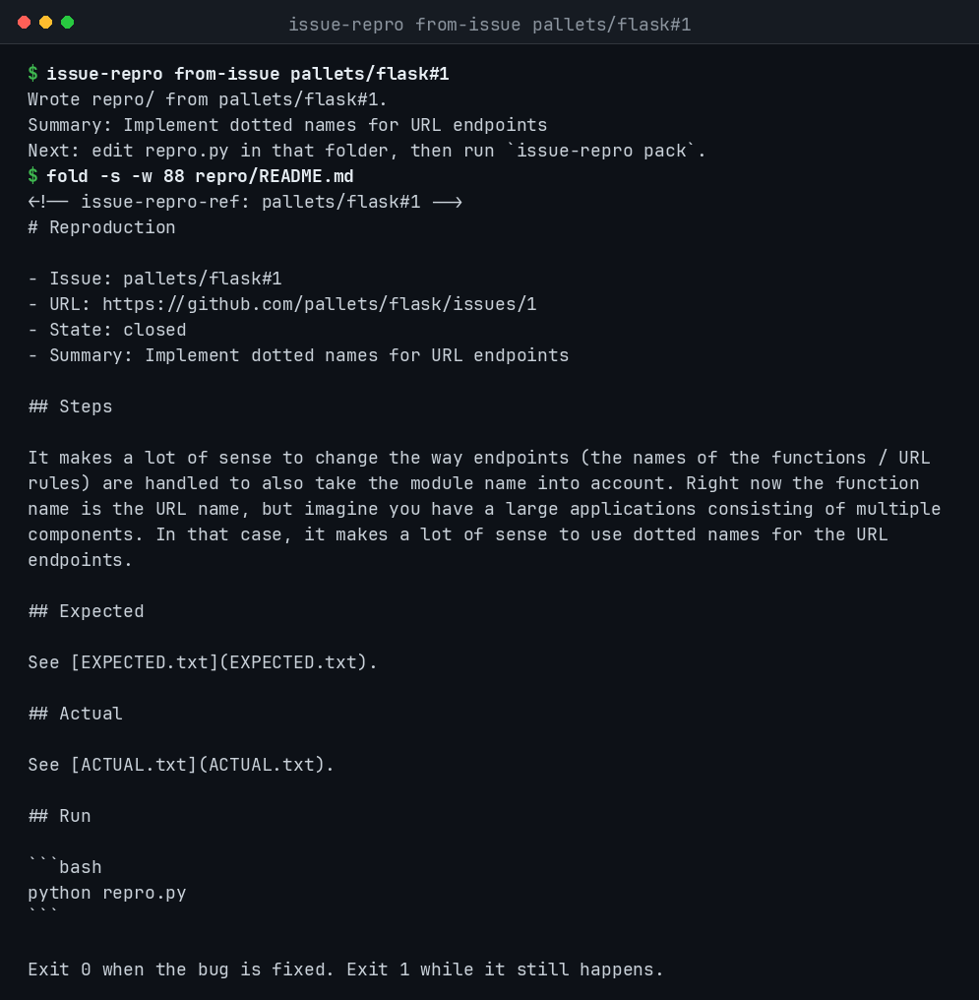
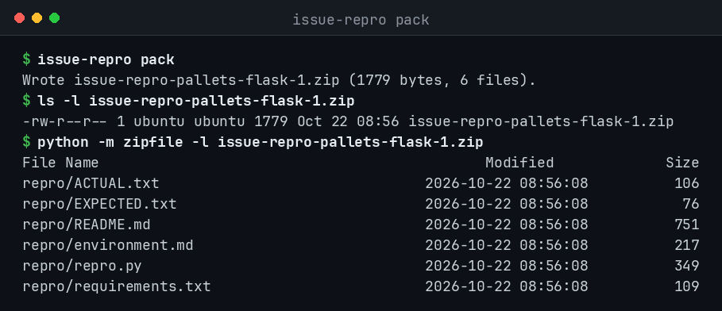

[English](README.md) · **简体中文** · [繁體中文](README.zh-TW.md) · [日本語](README.ja.md)

# issue-repro

`issue-repro` 用来准备一份别人能跑起来的 GitHub issue 复现材料。它会写出一个小目录，里面有脚本、环境说明，以及期望结果和实际结果。确认脚本能复现问题之后，用 `pack` 打成 zip，附到 issue 上。

需要 Python 3.10 或更新版本。运行时只用标准库。

## 安装

在本仓库里：

```bash
pip install -e .
issue-repro --version
```

安装后可以得到 `issue-repro` 命令。当前版本是 `0.1.0`。

## 命令

### init

写一份空白的 `repro/` 模板：

```bash
issue-repro init
```

- `README.md`：摘要、步骤、运行方式
- `environment.md`：操作系统、Python 版本，以及其他环境信息
- `requirements.txt`：需要固定版本的依赖
- `repro.py`：尽量小的复现脚本。改写之前，它以退出码 1 结束
- `EXPECTED.txt`：期望发生的事
- `ACTUAL.txt`：实际发生的事

`--dir` 可以换成别的目录名。`--force` 会覆盖这些模板文件，你另外放进目录的文件会保留。

### from-issue

用一条 GitHub issue 填写同一套模板：

```bash
issue-repro from-issue OWNER/REPO#123
issue-repro from-issue https://github.com/OWNER/REPO/issues/123
```

标题写入摘要，正文写入步骤。公开 issue 不需要 token。如果设置了 `GITHUB_TOKEN` 或 `GH_TOKEN`，命令会把它放进 `Authorization` 请求头。token 只出现在请求头里，不会写进目录或 zip。

如果请求失败，命令仍会写下空白模板，并把错误记在 `repro/README.md` 顶部。

### pack

```bash
issue-repro pack
```

在当前目录生成 `issue-repro-<slug>.zip`。目录来自某条 issue 时，slug 是 `owner-repo-123`；否则用项目目录名。`-o path.zip` 用来指定输出路径。压缩包里包含 `repro/` 目录。

## 示例

```bash
issue-repro from-issue pallets/flask#1
# 编辑 repro/repro.py，让问题还在时脚本失败
python repro/repro.py
issue-repro pack
```

生成的文件是 `issue-repro-pallets-flask-1.zip`。可以把它附在 issue 上，也可以留在本地。

## 截图

下面是这个版本实际跑出来的终端记录。

`issue-repro --version` 和 `issue-repro --help`：



`issue-repro init` 以及生成的 `repro/` 文件（`repro.py` 退出码为 1）：



对公开 issue `pallets/flask#1` 执行 `from-issue` 之后的 README：



`issue-repro pack` 生成的 zip：



## 开发

```bash
pip install -e ".[dev]"
ruff check .
pytest
```

见 [CONTRIBUTING.md](CONTRIBUTING.md)。

## 许可证

[MIT](LICENSE)
